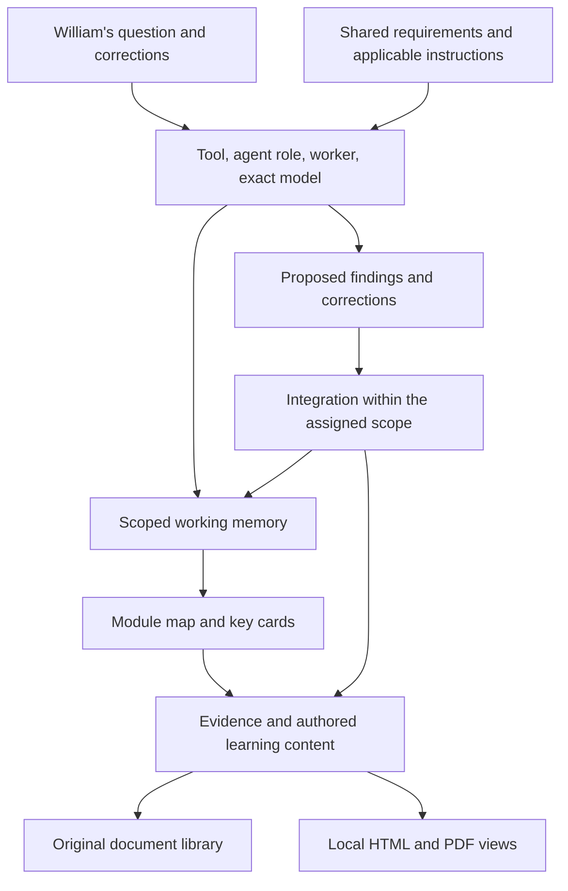

# Structure and boundaries

One evidence base supports many agents and readable views. Memory helps find it;
memory does not become a second, unsupported source of facts.

| Area | Responsibility | Boundary |
|---|---|---|
| `system/` | Shared requirements, tool adapters, roles, model profiles, skills | Instructions; no research findings |
| `memory/` | Current work, decisions, scoped observations and handoffs | Navigation and resumable state; no learning scores |
| `catalog/` | Key cards, source records, module entry links | Links to evidence; no duplicate original library |
| `modules/` | Module registry and new module contracts | Existing field contents stay at their current paths |
| Existing field folders | Evidence and learning-page sources | Their local rules continue to apply |
| `tools/` | Context routing, incremental indexing, validation | No execution of downloaded source code |
| `library/` | Future local originals | Ignored contents, tracked instructions; not yet migrated |
| `output/` | Future reproducible reading outputs | Ignored contents; not the sole copy of authored work |
| `.local/` | Search cache and other local runtime state | Ignored contents; not a durable shared knowledge store |

Identity has four independent fields:

- **Tool:** the host, such as Codex or Claude Code. Tool adapters describe how to
  find the shared instructions; they do not assume model capabilities.
- **Role:** researcher, integrator, reviewer, or maintainer. It describes the job.
- **Agent ID:** a stable worker identity for one assignment, with owned paths and
  a handoff. Two instances of the same model still need different IDs.
- **Model key:** an exact provider/model identifier mapped to a filesystem-safe
  key. Unknown remains unknown. Never use a model family as an exact identity.

Module contracts describe content roots, entry files, dependencies, and status.
Dependencies are read relationships, not inherited write permission. Shared
concepts have one canonical owner; other modules link to that owner's record.
Voice software and quant code may live in separate repositories later. Their
connectors must return stable source IDs and versions rather than machine paths.

This version supplies file conventions and local tools, not a permissions
enforcement service, scheduler, voice server, or automatic memory promotion.
The host enforces actual access. Shared edits have a named owner and a reviewable
diff; agents may not bypass host permissions by changing a role file.

Failure condition: summaries can hide old assumptions or contrary evidence.
Keep support links, file fingerprints, contradictions, and review dates. A fresh
agent should find the relevant source without reading unrelated modules. If it
cannot, repair the map; do not expand its startup prompt to the whole vault.
